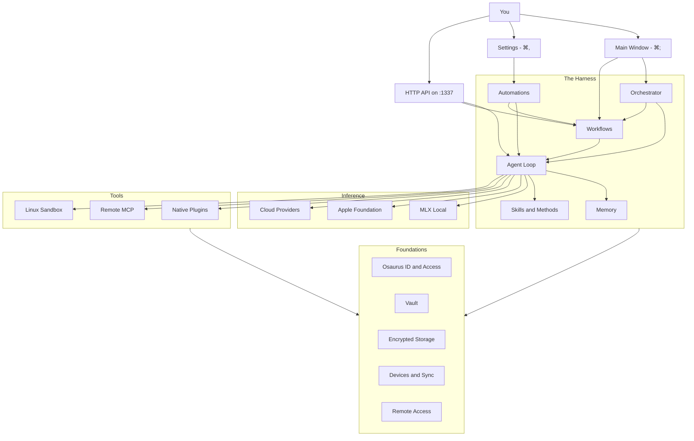

# Architecture

This page is for developers building on Osaurus — plugins, scripts, or integrations — who want a map of how the pieces connect before reading the deeper pages.

It maps the user-facing surfaces (the main window, Settings, the HTTP API) to the components underneath, and points to the reference page for each layer.

## The harness

Osaurus presents three entry points:

- **The main window** (`⌘;`) — the daily driver. Its navigation rail has **Chat** and **Workflows** at the top, **Usage** and **Settings** at the bottom.
- **Settings** (`⌘,`, inside the main window) — agents, automations, the Inbox, Vault, models, capabilities, sharing, and developer tools
- **The HTTP API** (on `:1337`) — OpenAI / Anthropic / Open Responses / Ollama / MCP, media, agent and workflow runs, webhooks, and loopback configuration

The built-in **Orchestrator** routes each request: it answers directly, hands settings changes to the **Configurator**, hands workflow building to the **Architect**, runs saved **workflows**, or sends work to custom agents and its built-in helpers. Every run funnels into the same **agent loop**, which talks to your **memory**, **skills/methods**, and is started by **automations** as well as by people. Inference goes out to local MLX, Apple Foundation, or any cloud provider you've connected. Tools span native plugins (v1–v6 ABI), remote MCP servers, and the Linux sandbox. Underneath everything: **identity** (Osaurus ID, signed requests, access keys), the **Vault** for secrets, **local storage** (with opt-in SQLCipher encryption), **sync** between your devices, and **Remote Access** (relay tunnels).

## How the pieces fit together

## Layers

| Layer | What it does | Reference |
|---|---|---|
| **Entry points** | Main window (`⌘;`), Settings (`⌘,`), HTTP API on `:1337` | [Chat](/chat), [HTTP API](/api), [CLI](/cli) |
| **Harness** | Orchestrator, Configurator, Architect, custom agents, workflows, automations, background tasks, memory, skills/methods — the continuity layer | [Orchestrator](/orchestrator), [Workflows](/workflows), [Automations](/automations), [Working in Chat](/agent-loop), [Tasks](/tasks), [Memory](/memory), [Skills](/skills), [Methods](/methods) |
| **Inference** | MLX local models, Apple Foundation Models, cloud providers — all behind the same picker | [Models](/models), [Apple Intelligence](/models/apple-intelligence), [Inference Runtime](/inference-runtime) |
| **Tools** | Native built-ins ([web search](/web-search), [browser use](/browser-use), [Apple Apps](/apple-apps)), registry plugins, remote MCP aggregation, workflow tools, and the Sandbox | [Tools & Plugins](/tools), [Plugin Authoring](/plugin-authoring), [Sandbox Internals](/sandbox), [Remote MCP Providers](/remote-mcp-providers) |
| **Foundations** | Osaurus ID (signed requests, `osk-v1` keys, website sign-in), Vault, local storage (opt-in SQLCipher), on-device Privacy Filter, Devices & Sync, Remote Access | [Identity Cryptography](/identity-internals), [Vault](/vault), [Storage & Encryption](/storage), [Privacy Filter](/privacy-filter), [Devices & Sync](/devices), [Remote Access](/remote-access) |

## Entry points

### Main window

Summoned with `⌘;` from anywhere on macOS. **Chat** holds tabs, a sidebar of agents and projects, and a context panel for history and file changes; you can open as many windows as you like. Each tab has its own agent, Working Folder or Sandbox mode, model selection, and conversation history, so you can run several agents side by side. **Workflows** is the library of saved workflows, where the Architect builds and tests them. [Chat →](/chat) · [Workflows →](/workflows)

Voice input lives here too: the microphone in the input bar, plus Wake Word activation and global Transcription Mode.

### Settings

`⌘,`, or the gear at the bottom of the navigation rail. The sidebar pins **Agents** (with the Orchestrator, Architect, Configurator, and Delegation pages), **Automations**, and **Inbox** (everything waiting on your answer) at the top, then groups:

| Group | Pages |
|---|---|
| General | General, Chat, Vault, Osaurus ID (with Wallet & Credits), Privacy & Security |
| Sharing | Workspaces, Access, Devices |
| Models | Local Models, Providers, Model Defaults |
| Capabilities | Tools & MCP, Channels, Agent Runtimes, Web Search, Voice, Images & Video, Computer & Browser Use |
| Context | Memory, Projects, Knowledge, Skills |
| Developer Tools | Server, Sandbox, Insights, Tasks |

Native plugins and MCP connections live inside Tools & MCP; Claude plugin bundles live inside Skills. [Workspaces](/workspaces) connect you with teammates' shared agents and workflows, and [Devices & Sync](/devices) keeps your Macs and iPhone in step.

### HTTP API

A local server on port 1337 (configurable). Speaks OpenAI Chat Completions, Anthropic Messages, Open Responses, and Ollama Chat APIs side by side, plus MCP endpoints, media generation, agent runs, workflow runs and their forms, webhook automations, Memory, agent invites and the secure channel, loopback-only declarative configuration under `/admin/config/*`, and the [`osaurus import`](/bundles) back end. An opt-in local access key can require keys from callers on this Mac too ([Security](/security)).

## Harness

The harness is what makes Osaurus more than a thin SDK shim:

- **Orchestrator** — the default agent. It routes rather than doing the work itself: no file tools and no `spawn_agent`. Settings changes go to the **Configurator**; building workflows goes to the **Architect**; saved workflows marked **Osaurus can run this for you** run through `run_workflow`; research, files, browsing, and code go to four built-in **helpers** (Research, Files, Browser, Code). [Orchestrator →](/orchestrator)
- **Custom agents** — your own agents, each with its own model, tools, sandbox, and memory. They delegate with `spawn_agent`. Fresh installs get a starter team: Planner, Courier, Keeper, Scout, and Builder. [Agents →](/agents)
- **Workflows** — typed, repeatable multi-step tasks that the Architect designs, tests, and fixes. A saved workflow runs from the Workflows page, from chat, as a `workflow_<slug>` tool on an agent, from the Orchestrator, or from an automation, and pauses with a form when it needs your input. Runs are recorded in `~/.osaurus/workflows/runs.sqlite`. [Workflows →](/workflows)
- **Automations** — triggers that start an agent or a workflow: a schedule, a folder change, a webhook, an RSS or SSE feed, a failed run, or app events. Each run goes through a background task queue. [Automations →](/automations) · [Tasks →](/tasks)
- **Agent Loop** — every chat is an agent loop. The model writes a todo list, calls tools, iterates, and ends with a verified summary or pauses to ask one critical question. [Working in Chat →](/agent-loop)
- **Memory** — persistent on-device memory with four layers (identity, pinned facts, episodes, and the raw transcript, which is read only for literal recall or as a search fallback). Distillation runs once per session, gated on a configured Core Model.
- **Skills & Methods** — reusable capabilities. [Skills](/skills) are markdown packages of expertise; [Methods](/methods) are scored YAML procedures the agent saved from past runs. Both are discovered and loaded on demand via `capabilities_discover` / `capabilities_load`.
- **Runtimes** — an agent can run on an external harness instead of the built-in loop. `HarnessRuntimeStore` holds the registered runtimes (Claude Code is seeded on first launch; Pi RPC programs are user-added), and each chat gets its own long-running harness process with a scoped agent token for calling back into Osaurus. [Runtimes →](/harness-runtimes)
- **Configuration, templates, and bundles** — one declarative document describes agents, automations, channels, providers, and more, with a version history you can compare and revert. [Agent templates](/agent-templates) are portable, optionally signed agent definitions; [Osaurus Bundles](/bundles) let an installer provision agents, skills, MCP servers, and runtimes through `osaurus import`, applied through the same engine. [Configuration →](/configuration)

Plugins, automations, workflows, channels, and the HTTP API all dispatch through the same agent loop — same engine, same loop tools, same intercepts. Sessions are tagged with their source (`chat`, `plugin`, `http`, `channel`, `automation`, `self_schedule`, `imported`, `delegation`, or `workspace`) so you can audit what started each conversation.

## Inference

Local options and a cloud surface, all behind the same model picker:

- **MLX** — local transformer / SSM models, optimized for Apple Silicon via vmlx-swift-lm's `BatchEngine` (continuous batching, content-addressed prefix caching). [Inference Runtime →](/inference-runtime)
- **Apple Foundation Models** — Apple's on-device system model (`model: "foundation"`) on macOS 26+. Zero downloads, zero config.
- **Cloud providers** — OpenAI, Anthropic, Gemini, xAI, Venice AI, OpenRouter, Ollama, LM Studio, or any endpoint that speaks the OpenAI, Anthropic, or Open Responses format — plus the hosted **[Osaurus Router](/osaurus-router)** (shown as Osaurus Cloud in the picker). Keys live in the [Vault](/vault). [Remote Providers →](/remote-providers)

Memory and agent context persist across all of them — switching from a local model to a cloud one doesn't lose what your agent has learned about you.

## Tools

An append-only host ABI for native plugins, **v1 through v6**:

- **v1** — tools only
- **v2** — full host API: HTTP routes, SQLite-backed config, web app serving, agent dispatch, inference, events
- **v3–v6** — streaming cancellation, agent-context introspection, structured logging, and a host-side string free path, each added without breaking older plugins

[Web search](/web-search) and [browser use](/browser-use) are native built-ins — no plugin install needed.

Plus **remote MCP providers** to aggregate tools from external MCP servers (with elicitation, progress, and annotation-driven default approvals; `ExternalMCPToolPolicy` deny lists still apply on top), **workflow tools** (`workflow_<slug>` for an agent's workflows, `run_workflow` for the Orchestrator), and the **Sandbox** for safe code execution: on macOS 26+ a Linux VM with one container per agent, each with its own filesystem, Linux user, and bridge socket; on macOS 15 a Seatbelt-confined host runner. The sandbox also accepts JSON-recipe plugins so agents can extend themselves without compiling anything.

Every tool — built-in, folder, sandbox, plugin, MCP-aggregated — returns the same canonical [Tool Contract](/tool-contract) envelope.

## Foundations

The trust layer underneath everything:

- **Osaurus ID** — secp256k1 master key in iCloud Keychain (biometric-gated), deterministic per-agent child keys, Apple App Attest device assertion, `osk-v1` access keys for external callers (scoped, expirable, revocable), signed agent invites, and [Log in with Osaurus](/login-with-osaurus) (`osl-v1` assertions) for websites. [Identity Cryptography →](/identity-internals)
- **Vault** — one store for API keys, tokens, passwords, and variables that agents, MCP servers, plugins, channels, and workflows use. Values live in the macOS Keychain; metadata and per-agent bindings in `~/.osaurus/credentials/`. [Vault →](/vault)
- **Storage** — SQLite across chat history, memory, methods, tool index, workflow runs, automations, and plugin databases; FileVault covers at-rest protection by default, with opt-in SQLCipher whole-database encryption (key in macOS Keychain, device-bound). Large attachments spill to content-addressed blobs. [Storage & Encryption →](/storage)
- **Devices & Sync** — end-to-end encrypted sync of chats between your Macs and iPhone, and running agents for your other devices. [Devices & Sync →](/devices)
- **Remote Access** — secure WebSocket tunnels through the relay at `agent.osaurus.ai`, per agent. The agent's cryptographic address is the routing key. No port forwarding. [Remote Access →](/remote-access)

These are the boundaries. See [Security & Privacy](/security) for the user-facing summary.

## Where to go next

Build a thing:

- [HTTP API](/api) — endpoint reference, streaming, function calling, workflow runs
- [SDK Examples](/sdk-examples) — Python, JavaScript, Anthropic SDK, Open Responses, starting a workflow
- [CLI](/cli) — `osaurus serve / mcp / tools / run / config / import`
- [Tools & Plugins](/tools) → [Plugin Authoring](/plugin-authoring) → [Tool Contract](/tool-contract)
- [Sandbox Internals](/sandbox) — VM, per-agent containers, host bridge, plugin recipes
- [Log in with Osaurus](/login-with-osaurus) — let people sign in to a website with their Osaurus ID

Understand a piece:

- [Inference Runtime](/inference-runtime) — `BatchEngine`, KV cache, model leases
- [Identity Cryptography](/identity-internals) — full crypto spec
- [Storage & Encryption](/storage) — the plaintext default, opt-in SQLCipher, recovery
- [Configuration](/configuration) — declarative documents, history, storage paths
- [Global Proxy](/global-proxy) — routing outbound traffic through one validated proxy
- [Developer Tools](/developer-tools) — Insights and the Server → API Reference tab in Settings
- [Building from Source](/developer) — clone, build, test, contribute
