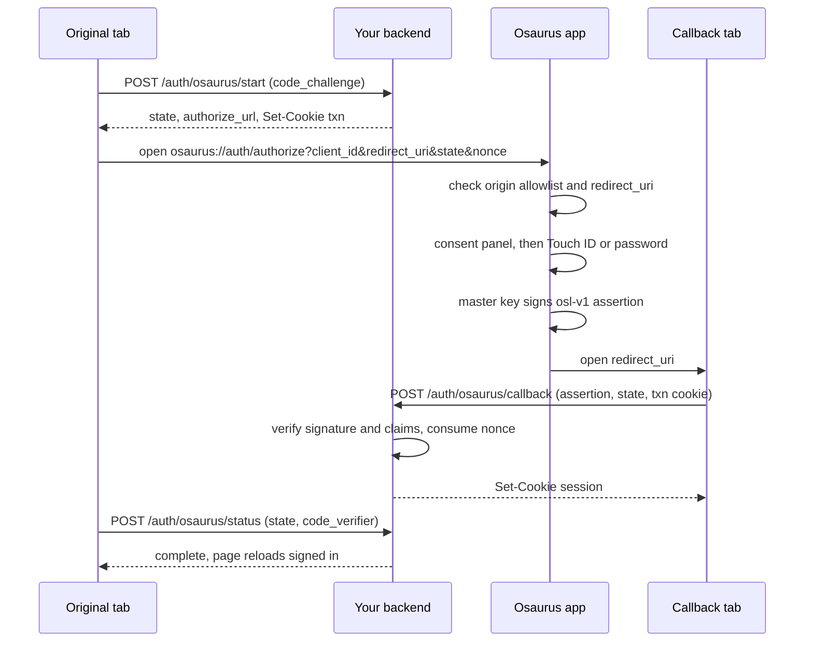

# Log in with Osaurus

Log in with Osaurus lets someone sign in to a website with the [Osaurus ID](/identity) they already have on their Mac, with no password and no Osaurus login server. This page is for web developers building a site that offers that button.

The site opens Osaurus, the person approves the request and confirms with Touch ID, and Osaurus hands the browser a short-lived, single-use **login assertion** signed by their master key. Your backend checks the signature itself, with any Ethereum signature library, and starts its own session.

:::note[First-party sites only, for now]
Version 1 (`osl-v1`) works only for origins built into the app: `https://store.osaurus.ai`, `https://osaurus.ai`, and `https://www.osaurus.ai`. Osaurus silently refuses any other origin, so a third-party site can't offer the button yet. Debug builds can add origins for local development ([below](#local-development)).
:::

The reference relying party, which you can run and copy from, is upstream in [`docs/examples/login-with-osaurus/`](https://github.com/osaurus-ai/osaurus/tree/main/docs/examples/login-with-osaurus). The full protocol document is [`docs/LOGIN_WITH_OSAURUS.md`](https://github.com/osaurus-ai/osaurus/blob/main/docs/LOGIN_WITH_OSAURUS.md).

## What the person sees

1. They click **Log in with Osaurus** on your site. Their browser asks to open Osaurus.
2. Osaurus shows a panel, "Sign in to store.osaurus.ai?", naming your exact origin and what your site will receive: their address, and their Osaurus ID handle if they've claimed one.
3. They click **Continue**, then confirm with Touch ID (or their login password on a Mac without it).
4. Osaurus opens your callback page in their default browser, and the original tab reloads signed in.

They can review recent sign-ins in **Settings → Osaurus ID → Sign In with Osaurus**, under **Recent Sign-ins**.

## How it works



1. The page asks your backend to start a login. The backend creates a transaction (`state`, `nonce`, the page's PKCE `code_challenge`, 5-minute expiry) and sets a transaction cookie in this browser.
2. The page navigates to `osaurus://auth/authorize?…`. The browser hands the link to Osaurus; the page stays where it is.
3. Osaurus refuses any origin not on its allowlist, then shows the consent panel.
4. On **Continue** and Touch ID, Osaurus reads the master key, signs the assertion, and wipes the key from memory.
5. Osaurus opens `redirect_uri` in the default browser with the assertion in the URL fragment. The callback page posts it to your backend, which verifies it, consumes the nonce, and sets the session cookie.
6. The original tab shares that cookie. It learns the login finished from a `BroadcastChannel` message and by polling `/status` with its `code_verifier`, then reloads.

## Integrating a site

You need two pages and three endpoints. In the reference example, `verify.ts` implements the endpoint logic (`OsaurusLoginRelyingParty`), `client.js` the browser side (`startOsaurusLogin`, `handleOsaurusCallback`), and `server.ts` wires them into a runnable server.

| Piece | What it does |
| --- | --- |
| Button page | Calls `startOsaurusLogin()`; reloads when it resolves. |
| `GET <redirect_uri>` | Static page that calls `handleOsaurusCallback()`. |
| `POST /auth/osaurus/start` | `rp.start({ codeChallenge })`; set the transaction cookie; return `{ state, authorize_url }`. |
| `POST /auth/osaurus/callback` | `rp.callback({ assertion, state, transactionId })`; on success create your session for `claims.iss`. |
| `POST /auth/osaurus/status` | `rp.status({ state, codeVerifier, transactionId })`; tells the original tab when to reload. |

```ts
import { OsaurusLoginRelyingParty } from "./verify";

const rp = new OsaurusLoginRelyingParty({
  origin: "https://store.osaurus.ai",
  redirectUri: "https://store.osaurus.ai/auth/osaurus/callback",
  store: new RedisLoginTransactionStore(), // anything with an atomic pending -> complete update
});

// POST /auth/osaurus/callback
const claims = await rp.callback({
  assertion,
  state,
  transactionId: req.cookies["__Host-osl_txn"],
});
await createSession(res, { accountId: claims.iss, osaurusIdHint: claims.osaurus_id });
```

Requirements:

- Serve the button page, callback page, and endpoints from the **same origin** you send as `client_id`. `redirect_uri` must be on that origin.
- The transaction cookie is `HttpOnly; Secure; SameSite=Lax` (a `__Host-` prefix is recommended), lives no longer than the transaction (5 minutes), and is cleared on success.
- The three endpoints accept same-origin `POST` only (check the `Origin` header) and respond with `Cache-Control: no-store`.
- The callback page sends `Referrer-Policy: no-referrer` and removes the fragment from history before doing anything else (`client.js` does).
- Key accounts on `iss`, the lowercase master address. It is the same for the person on every Osaurus site and every one of their Macs.
- Treat `osaurus_id` as a display hint only. It is what the Mac last saw, not proof of the handle; never authorize on it.
- Issue your own session with your own lifetime. The assertion is a one-time proof, not a bearer token: don't store it or forward it.

### When Osaurus isn't installed

Browsers give no signal when a custom-scheme link goes unhandled. `startOsaurusLogin({ onNotInstalled })` fires the callback if the page never lost focus 2.5 seconds after opening the link; show a download link then. Keep the login pending, so someone who installs and opens Osaurus within the 5 minutes can click again.

### Callback in a different browser

Osaurus opens `redirect_uri` in the **default** browser. If the login started in another browser, the callback has no transaction cookie and fails with `browser_mismatch` without consuming the nonce. `handleOsaurusCallback` exposes a `continueURL` to show; pasted into the browser the login started in, it completes normally until the assertion expires. Tell people to paste it only into another browser on the same Mac and never to send it to anyone.

## Protocol reference

### Authorization request

```
osaurus://auth/authorize?client_id=<origin>&redirect_uri=<url>&state=<opaque>&nonce=<opaque>[&response_mode=fragment|query]
```

| Parameter | Required | Rules |
| --- | --- | --- |
| `client_id` | yes | A bare origin, `https://host[:port]`, with no path, query, fragment, or credentials (a trailing `/` is tolerated). Compared after lowercasing and dropping the default port. Must be on the allowlist. |
| `redirect_uri` | yes | Absolute URL on exactly the `client_id` origin. May have a query; no fragment or credentials. At most 2048 characters. |
| `state` | yes | 1–512 characters from `A-Z a-z 0-9 - . _ ~`. Echoed back unchanged. Bind it to the transaction. |
| `nonce` | yes | 16–128 characters from the same set. Signed into the assertion. Use at least 128 bits of randomness and accept it once. |
| `response_mode` | no | `fragment` (default, recommended) or `query`. |

A parameter given twice makes the request invalid. Unknown parameters are ignored.

### Response

Osaurus opens `redirect_uri` with form-encoded parameters in the fragment (or appended to the query in `query` mode):

| Outcome | Parameters |
| --- | --- |
| Success | `assertion`, `state` |
| Error | `error`, `error_description` (developer-facing English, may change), `state` (omitted only when the request's own `state` was invalid) |

```
https://store.osaurus.ai/auth/osaurus/callback#assertion=osl-v1.eyJ...X0.0x88f3...1c&state=st_8f2b1c
```

When `client_id` isn't allowed or `redirect_uri` is invalid, nothing opens: the person sees an error in Osaurus and your page never hears back.

### Assertion format

```
osl-v1.<payload>.<signature>
```

- `payload` is base64url (no padding) of a UTF-8 JSON object. Always verify against the payload string exactly as received; don't re-encode or depend on key order.
- `signature` is `0x` plus 130 hex characters: the 65-byte `r || s || v` secp256k1 signature, `v` in 27 or 28.
- The signed message is the UTF-8 string `osaurus-login-v1.` followed by the `payload` string, signed with EIP-191 `personal_sign`. The recovered address is the signer.

| Claim | Type | Meaning |
| --- | --- | --- |
| `typ` | string | Always `osaurus-login`. |
| `ver` | number | Always `1`. |
| `iss` | string | Lowercase master address (`0x` plus 40 hex). The person. |
| `aud` | string | The canonical `client_id` origin the assertion is for. |
| `redirect_uri` | string | The `redirect_uri` the request carried. |
| `nonce` | string | The request's `nonce`. |
| `iat` | number | Signing time, Unix seconds. |
| `exp` | number | `iat + 300`. |
| `jti` | string | Unique id for this assertion. Log it. |
| `osaurus_id` | string, optional | Claimed Osaurus ID without `@`, if the Mac knows one. Display hint only. |
| `dev` | string, optional | Device id of the signing Mac (8 hex). Useful for "signed in from" displays. |

The `osaurus-login-v1.` prefix keeps login signatures apart from every other message Osaurus signs with the master key, so a login can't be replayed as anything else, or the reverse.

## Verifying an assertion

Your backend **must**, in this order:

1. Split on `.` into exactly three parts: the first is `osl-v1`, the payload is base64url, and the signature matches `^0x[0-9a-fA-F]{130}$`.
2. Decode the payload JSON and read `iss`.
3. Verify that the EIP-191 signature of `osaurus-login-v1.<payload as received>` recovers `iss` (case-insensitive).
4. Check `typ == "osaurus-login"` and `ver == 1`.
5. Check `aud` equals your origin exactly, and `redirect_uri` equals your registered callback exactly.
6. Look up the transaction by `state`. Check it is pending, unexpired, and belongs to this browser (the transaction cookie), and that `nonce` matches.
7. Check `exp - iat <= 300`, `iat <= now + 60`, and `exp > now - 60` (60 seconds of clock skew).
8. Atomically mark the transaction complete. If it was already complete, reject it as a replay.

Only then create the session. With viem, step 3 is:

```ts
const ok = await verifyMessage({
  address: claims.iss,
  message: "osaurus-login-v1." + payload,
  signature,
});
```

The upstream [`vector.json`](https://github.com/osaurus-ai/osaurus/blob/main/docs/examples/login-with-osaurus/vector.json) is a complete test vector signed with a public test key; run `npm run check-vector` in the example folder to check your verifier against it.

## Error codes

| `error` | When | Suggested message |
| --- | --- | --- |
| `access_denied` | The person chose Cancel, closed the panel, ignored it for 2 minutes, or cancelled or failed Touch ID. | "Sign-in cancelled." Offer to retry. |
| `login_required` | This Mac has no Osaurus ID yet. Osaurus opens its Osaurus ID settings. | "Set up your Osaurus ID in Osaurus, then try again." |
| `temporarily_unavailable` | Another sign-in is already waiting for the person. | "Finish the other sign-in in Osaurus first." |
| `invalid_request` | `state`, `nonce`, or `response_mode` failed validation. A bug in your site. | Generic error; log `error_description`. |
| `server_error` | Osaurus couldn't read the key or sign. | "Something went wrong in Osaurus." |

The reference verifier's own error codes are `malformed`, `bad_signature`, `wrong_type`, `audience_mismatch`, `redirect_uri_mismatch`, `nonce_mismatch`, `lifetime_too_long`, `issued_in_future`, `expired`, `unknown_state`, `browser_mismatch` (HTTP 409), and `already_used`.

## Security model

A verified assertion proves that the person holding the master key behind `iss` approved, moments ago, signing in to exactly this origin for exactly this login attempt, after unlocking with Touch ID or their password on one of their Macs.

| Threat | Mitigation |
| --- | --- |
| Phishing site requests a login | Not on the allowlist: refused before any prompt. |
| Allowed site asks to deliver to an attacker URL | `redirect_uri` must be on the `client_id` origin. |
| Assertion leaked (history, logs, extension) | Fragment delivery keeps it out of server logs and `Referer`; the callback strips it from history; it is single-use, 5-minute, and audience-bound. |
| Replay of a captured assertion | The nonce is consumed atomically on first use. |
| Attacker starts a login and gets the victim to approve it | The callback lands in the victim's browser without the attacker's transaction cookie (`browser_mismatch`), so no session is created. |
| Attacker forces their own login into the victim's browser | The callback needs the transaction cookie that `/start` set in that browser. |
| Clock tampering on the Mac | You check with your own clock, 60 seconds of skew, and a 300-second lifetime cap. |
| Malicious local app opens `osaurus://auth/authorize` | It can only show the panel for an allowlisted site, still needs Touch ID, and the result goes to that site in the browser. |

Every login needs a fresh Touch ID or password check after the consent panel; an unlocked Mac never approves a login by itself. The master key is read only then, used once, and zeroed. It never leaves the Mac.

Residual risks:

- Anyone who can unlock the Mac with Touch ID or the password can sign in as its owner, the same boundary as the rest of the Osaurus ID.
- The `browser_mismatch` link carries a live assertion. Word that message as "copy this into another browser on this Mac; never send it to anyone", or drop the fallback.
- Accounts key on the master address, so someone who resets their Osaurus ID (a new master key) appears as a new account. Restoring from the recovery phrase keeps the same address.

## Local development

Release builds accept only the built-in origins. Debug builds of Osaurus also read extra origins, including plain-http loopback ones, from a user default:

```bash
defaults write com.dinoki.osaurus ai.osaurus.loginWithOsaurus.extraClientOrigins -array "http://localhost:8787"
```

Then run the example site from an Osaurus checkout ([Building from Source](/developer)):

```bash
cd docs/examples/login-with-osaurus
npm install
ORIGIN=http://localhost:8787 npm start
npm run check-vector   # verifier conformance against vector.json
```

Open `http://localhost:8787` in your default browser and click **Log in with Osaurus**. Remove the override with `defaults delete com.dinoki.osaurus ai.osaurus.loginWithOsaurus.extraClientOrigins`.

## Limits

- **First-party only.** Third-party sites need a client registry and a stronger consent design, which v1 doesn't have.
- **No silent re-authentication.** Every login shows the panel and asks for Touch ID. Keep people signed in with your own sessions.
- **No access to Osaurus itself.** An assertion grants nothing inside Osaurus. Apps that call a person's Osaurus server still use `osk-v1` access keys; see [HTTP API](/api).
- **Not OAuth or OpenID Connect.** The parameters are OAuth-shaped so a central server could wrap the flow later, but there are no ID tokens today.

---

**Related:**

- [Osaurus ID](/identity) — the identity people sign in with
- [Identity Cryptography](/identity-internals) — master keys and signing
- [HTTP API](/api) — access keys for calling an Osaurus server
