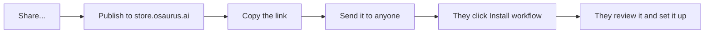

# Share a Workflow

Made a workflow that saves you time? Someone else probably needs it too. Share it with a link, and anyone with the link can see what it does and install it on their own Mac in a couple of clicks.

They run it with their own accounts and keys. Yours never leave your Mac.

## Share it with a link in about a minute

You need an [Osaurus ID](/glossary#osaurus-id) to publish. If you don't have one yet, the Share sheet tells you, and **Open Identity Settings** takes you there to set it up.

1. Click **Workflows**, the second icon on the narrow strip along the left edge of the window.
2. Click the **…** next to the workflow you want to share and choose **Publish…**. (You can also click **Share…** at the bottom of a workflow's page, or on the card that appears right after you save one.)
3. Choose **Publish to store.osaurus.ai**.
4. Under **Who can see it**, choose **Unlisted**. Only people you give the link to can open it.
5. Check the name and description under **Listing Details**. This is what people see first. You can also pick up to three **Topics**, like Writing or Productivity.
6. Optional: click **Add Example Runs…** and pick a run or two, so people can see what it makes. Under each one, **What leaves this Mac** shows exactly what will be shown.
7. Read **What everyone will see**, then click **Publish**. Your Mac may ask for Touch ID or your password to sign it with your Osaurus ID.
8. A sheet appears saying your workflow **is live**. Click the copy button next to the link.

Done. Your workflow has its own page on store.osaurus.ai, and the link is on your clipboard.

## Send it anywhere

Paste the link wherever you talk to people:

- **In a message or email** to a friend or colleague who does the same task.
- **In your team chat**, so everyone stops doing it by hand.
- **In a post**, with the share card. The live sheet has a ready-made image of your workflow with its name, a short summary and a QR code. Use **Copy Image**, **Save Image…**, or **Share…** to post it.
- **In person**: let them scan the QR code with their phone.

Some ideas: share **Email Reply** tuned to your company's tone with your support team. Send a meeting-notes workflow to everyone who takes notes in your weekly meeting. Post the workflow that writes your weekly update, so others can try it.

## Is this safe?

Yes. Sharing a workflow shares the recipe, not your data.

**Never shared:**

- Your keys, passwords and account sign-ins
- The answers you've typed into its forms
- Your files, and where they are on your Mac
- Your past runs (unless you add one as an example)

**What people can see** on the page, so they know exactly what they're installing:

- Every step it takes, and the full text of any code
- The websites it contacts
- The names of any keys it needs (never the values)
- The tools and models it uses

**Example runs** are only shown if you add them. Before publishing, you see exactly what each one shows, and any secret answers and file locations are removed. Pictures are saved again without their location or camera details.

**Nothing installs without a review.** When someone opens your link, Osaurus shows them every step before anything is added to their Mac. They set it up with their own models and keys.

**It's signed with your Osaurus ID**, so people can tell it really came from you. If anyone changes the file, it no longer shows as yours.

**You can take it down at any time.** See [Take it down](#take-it-down) below.

## Who can see it

| Choice | Who can open it | When it's live |
|---|---|---|
| **Unlisted** | Only people with the link | Right away |
| **Public** | Anyone. It's listed on store.osaurus.ai and on your author page | The link works right away; the listing appears after the Osaurus team approves it |
| **Password** | People with the link and a password you choose (6 to 128 characters) | Right away |
| **Workspace** | Members of up to 20 [workspaces](/glossary#workspace) you choose | Right away |

**Not sure? Start with Unlisted.** You can change who can see it later, at any time.

### Get listed on store.osaurus.ai

Choose **Public** to let anyone find your workflow by browsing or searching store.osaurus.ai.

1. Follow the steps above, but choose **Public** under **Who can see it**.
2. The button now reads **Submit for Review**. Click it.
3. Your link works straight away, so you can start sharing it. Until the Osaurus team approves it, the page says **Unlisted until approved**.

Once it's approved, it shows up in the store. Updates to a Public workflow are reviewed too. Your link keeps working while they are.

## What people see when they open your link

1. Your link opens the workflow's page on store.osaurus.ai: what it does, its steps, and any example runs.
2. They click **Install workflow**. Osaurus opens on their Mac. (They'll need Osaurus installed.)
3. Osaurus shows a review: every step, any code, the websites it contacts, the keys it needs, and whether it's signed by you.
4. They go through setup: pick their models, add their own keys, and give any permissions it needs. Anything they skip leaves it marked **Needs setup** until they finish.
5. It's ready to run on their Mac.

For safety, Osaurus only installs from links to store.osaurus.ai.

## Share as a file instead

Prefer not to publish a page? Save the workflow as a file and send it however you like, by email, AirDrop or a shared folder. No Osaurus ID or account needed.

1. Click the **…** next to the workflow and choose **Save as File…** (or click **Share…** and choose **Save as a file**).
2. Choose your options:
   - **Suggest the models I use**: tells the other person which models worked for you.
   - **Include how to connect my MCP servers**: tells them how to connect the same outside services ([MCP](/glossary#mcp) servers) your workflow uses. It includes the names of any keys, never the keys themselves.
   - **Sign with my Osaurus ID**: shows the file came from you.
3. Check **What they'll review**, then click **Save…**.

The file ends in `.osaurustemplate`. To install one, the other person clicks **Import** on their Workflows page, or drags the file onto it. They see the same review and setup as with a link.

## Manage a published workflow

Click the **Live** badge on a workflow (or **Manage Published…** in its **…** menu) to open its dashboard. There you can:

- See how many people installed it (**Installs**), its **Version**, and when it was **Published**.
- Change **Who can see it**, then click **Save**.
- Edit the name, description, **Topics** and **Example Runs**, then click **Save Listing**.
- Copy the link again, or **Open Page**.

### Publish an update

Improved your workflow? Save the changes as usual. The dashboard then shows **On this Mac, not published** and a button like **Publish v2** (or **Submit v2 for Review** if it's Public). Click it, and everyone who opens the link gets the new version. People who already installed it see an **Update to v2** chip on their workflow.

### Take it down

Click **Take Down…** on the dashboard. The page stops working for everyone. People who already installed it keep their copy.

Changed your mind? **Publish Again** brings the page back at the same link.

## Share with your team

If you're in a [workspace](/workspaces), there are two different ways to share:

- **Give them their own copy.** Choose **Workspace** under **Who can see it**. Members find it under **Workflows → Workspaces** and click **Install**. It runs on their Mac with their own keys and models.
- **Let them run yours.** Turn on **Teammates can run this** under **Who Can Start It** on the workflow's page. A teammate's agent can then start it, but it runs on your Mac with your keys and folders, and Osaurus asks you each time. Your Mac needs to be on for it to work.

## Troubleshooting

### It says "Needs an Osaurus ID"

Publishing signs the page with your Osaurus ID. Click **Open Identity Settings**, set up your Osaurus ID, then try again. Or choose **Save as a file**, which doesn't need one.

### It says "Published as Unlisted"

Your workflow went live, but the password or the workspace sharing didn't save. It's Unlisted for now. Click **Try Again**.

### Someone says the link won't install

- Make sure they have Osaurus on a Mac.
- If they see "Osaurus installs template links from store.osaurus.ai only", the link they used isn't the store link. Send them the link from your dashboard.
- If they see "This template is shared with a workspace you're not a member of", it's set to **Workspace**. Add them to the workspace, or change it to **Unlisted**.

### It says "Removed from store.osaurus.ai"

The Osaurus team took the page down, and it can't be published again from your Mac.

---

## Under the hood

- **Hostnames:** pages live on `https://store.osaurus.ai` (workflows under `/w/`, agent templates under `/a/`). The registry API is `https://api.store.osaurus.ai`.
- **Install link:** **Install workflow** is an `osaurus://templates-import?url=…` link. Osaurus accepts only template files hosted on the registry. A file from a link always goes through review and setup; it's never added and runnable in one step. **Advanced details** on the live sheet shows the **Install Link**, **Template File** URL and **Registry ID**.
- **Visibility values:** **Unlisted** is stored as `hidden` in the registry. A new **Public** submission starts unlisted and is listed once a version is approved. Unlisted, Password and Workspace skip review. If a password or workspace share fails after the upload, the page stays up as Unlisted.
- **Signing:** publishing always signs with your master key. One authentication prompt covers the file and the upload. Once a library version is signed, newer versions must be signed by the same ID. An edited file reads as unsigned; **Signature does not match** can't be imported.
- **What's in a template:** the steps, their schemas, model slots, secret names, MCP servers, plugins, tools, permissions and dependencies. Stripped from every export: secret values, saved answers, install bindings, run history and absolute paths. Anything that looks like a key in MCP connection hints becomes `YOUR_KEY`. Your own tags aren't exported.
- **Install receipts:** after someone installs, Osaurus sends a receipt signed with their Osaurus ID (`POST /workflows/:id/installs`). The registry counts one install per workflow per Osaurus ID. Without an Osaurus ID, no receipt is sent.
- **Share card:** a 1200×630 image with the name, summary, `@handle`, link and QR code.
- **Workspace sharing vs hosted runs:** workspace visibility shares a template that members install. **Teammates can run this** shares no template; a teammate's link appears under **All → On teammates' Macs** and each call goes through **Require Approval for Teammate Tool Calls**.
- **Agent templates** publish the same way. See [Agent Templates](/agent-templates).
