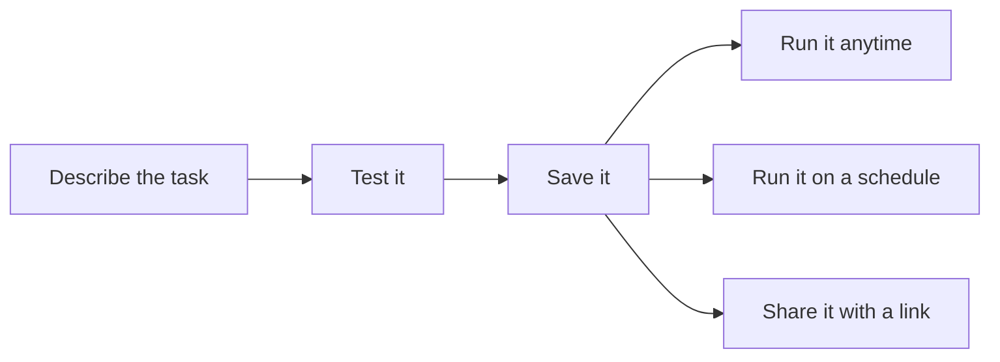

# Workflows

A workflow is a task Osaurus remembers how to do. You describe it once, check that it works, and from then on it runs the same way every time, with one click or on a schedule.

Osaurus comes with a few ready to use. You can build your own just by describing it in a chat, and you can share any workflow with a link.

## A morning with Morning Brief

It's 8 a.m. You could ask Osaurus "What's on my calendar today, what's due, and did anyone email me something I need to answer?" and wait while it works that out.

Or you click **Run** next to **Morning Brief**. A minute later you have one page: today's events, what's due, and the mail that needs a reply. Osaurus read your Calendar, Reminders and Mail right on your Mac, and wrote the page with a model on your Mac. Nothing left your computer.

Tomorrow, you can have that page waiting for you at 8 without clicking anything.

## Why use a workflow?

A chat is great for a one-off question. A workflow is for the things you do again and again.

- **No retyping.** You explain the task once. After that it's one click, or no clicks at all.
- **The same result every time.** A workflow follows the same steps in the same order, so a good result stays good.
- **You can see every step.** Before it runs, you can read exactly what it will do, in plain words.
- **You know what leaves your Mac.** Every workflow is marked **Runs on this Mac** or **Uses the cloud**, so there are no surprises.
- **It runs where you are.** Start it from the Workflows page, from a chat, by asking Osaurus, from one of your agents, or on a schedule.
- **You can share it.** Send someone a link and they can install your workflow on their own Mac, with their own accounts and keys.

## How it works

1. **Describe it.** Tell the [Architect](/glossary#architect), a helper that builds workflows for you, what you want in your own words. [Build with the Architect →](/workflows-build)
2. **Test it.** Run it once with an example to check the result.
3. **Save it.** It joins your workflows, ready to run.
4. **Use it.** [Run it](/workflows-run) whenever you like, [put it on a schedule](/automations), or [share it with a link](/workflows-share).

## Workflows that come with Osaurus

A fresh install of Osaurus comes with seven workflows, each run by one of your [teammates](/glossary#teammate) (the starter agents that look after your calendar, mail, files and research). They don't run until you run them or give them a time.

| Workflow | What you get | Who does it | Stays on your Mac? |
|---|---|---|---|
| **Morning Brief** | Today's events, what's due, and the mail that needs a reply, on one page. | Planner and Courier | Yes |
| **Meeting Prep** | Your next meeting: who, when, where, related notes, and recent mail with those people. | Planner, Keeper and Courier | Yes |
| **Mail Triage** | Your unread mail sorted into needs a reply, for your information, and can wait. Nothing is sent. | Courier | Yes |
| **New Download** | For each new file in Downloads: what it is, and a suggested name and place. Nothing is moved. | Keeper | Yes |
| **End of Day** | What happened today, what's still due, and tomorrow's first event. | Planner | Yes |
| **Research Brief** | A short note on any topic you type: the answer, the findings, and a source for every claim. | Scout | No: it searches the web |
| **Repo Digest** | What changed in a code project this week, and what's not saved yet. Only on Macs with developer tools. | Builder | Yes |

"Stays on your Mac" means Osaurus reads your apps and files on this Mac and writes the result with a [local model](/glossary#local-model). If you chose a cloud model when you first set up Osaurus, the writing step can use that model instead.

## Starters

Three **[Starters](/glossary#starter)** are ready-made writing helpers you can add in a click. They only write text; they don't read your mail, files or the web.

| Starter | You give it | You get |
|---|---|---|
| **Social Post Writer** | A topic, where it's going (LinkedIn, X or Instagram), and a tone | A post with hashtags |
| **Meeting Action Items** | Your meeting notes, pasted in | A summary, who does what, the decisions made, and a follow-up email |
| **Email Reply** | The email you got, what you want to say, and a tone | A subject line and a reply in that tone |

Starters use [Apple Intelligence](/models/apple-intelligence) when your Mac has it, and your default model otherwise.

To add one, click **Workflows** on the left edge of the window, click **New Workflow**, and pick it under **Or add a ready-made workflow**. You'll see a preview of the form and the result before you click **Add**.

## Find your workflows

Click **Workflows**, the second icon on the narrow strip along the left edge of the window, just under Chat.

The Workflows page shows:

- **Running now**: anything running at the moment, with **Stop**, and **Respond** if it's waiting for an answer from you.
- **All**: every workflow on this Mac, each with **Run** (or **Set Up** if it still needs something).
- **Drafts**: workflows you started with the Architect but haven't saved yet, with **Continue**.
- **Published**: workflows you've shared on the web.
- **Workspaces**: workflows your team shared, if you belong to a [workspace](/glossary#workspace).

Tabs only appear once they have something in them. Above the tabs, **New Workflow** (⌘N) starts a new one and **Import** brings one in from a file.

## Next steps

- [Build your own with the Architect](/workflows-build): describe a task, test it, and save it.
- [Run a workflow](/workflows-run): every way to start one, and what to do if something goes wrong.
- [Share a workflow](/workflows-share): get a link you can send to anyone in about a minute.
- [Automations](/automations): run a workflow every morning, or whenever a file arrives.

---

## Under the hood

- **What a workflow is, technically:** a fixed graph of steps with a typed input (the form) and a typed output (the result). Steps include model calls, forms, JavaScript or Python code, tool calls, web requests, waits, loops over a list, other workflows, agents, stored data, branches, channel replies, and image or video generation. Every model step must return an answer in the step's exact shape ([structured output](/glossary#structured-output)).
- **Built-in workflow files:** the seven built-ins ship in `Packages/OsaurusCore/Resources/Team/default-workflow-*.json` and the Starters in `Resources/Templates/workflow-template-*.json`. They're installed on fresh installs only, visible to the Orchestrator, with no schedule. Upgrades from Osaurus Classic and **Create starter agents** don't add them. Repo Digest ships only with Builder.
- **Model slots:** a built-in's writing step uses a model slot named `writer` that's limited to local models, unless the model chosen during setup was a cloud model. Starters allow the cloud for `writer` and prefer Apple Foundation Models.
- **Installed workflows** live in `~/.osaurus/workflows/`. A file edited outside Osaurus reads **Changed outside Osaurus** and won't run until you review it in **Set Up…**.
- **Not the same as a Method:** a [Method](/methods) is a tool sequence an agent saved from a chat. A workflow is built with the Architect and has a form and a result.
- **Developers:** the full model is in upstream [`docs/WORKFLOWS.md`](https://github.com/osaurus-ai/osaurus/blob/main/docs/WORKFLOWS.md). Runs can be started and answered over the [HTTP API](/api).
